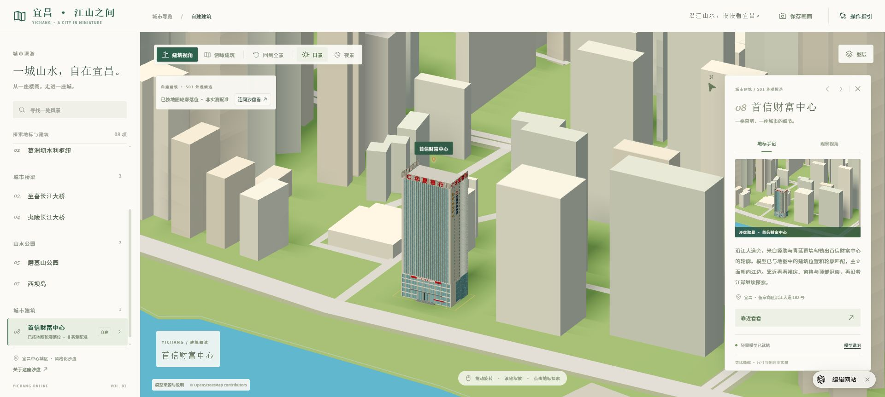
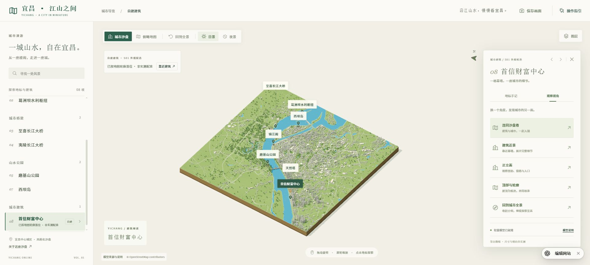
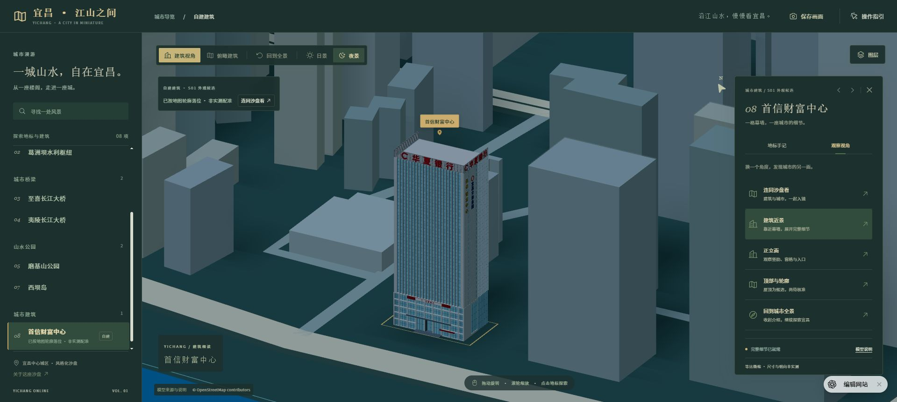
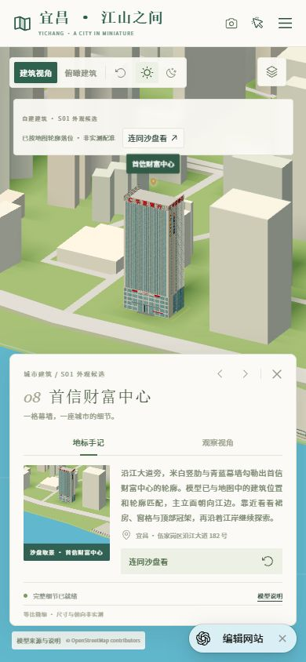
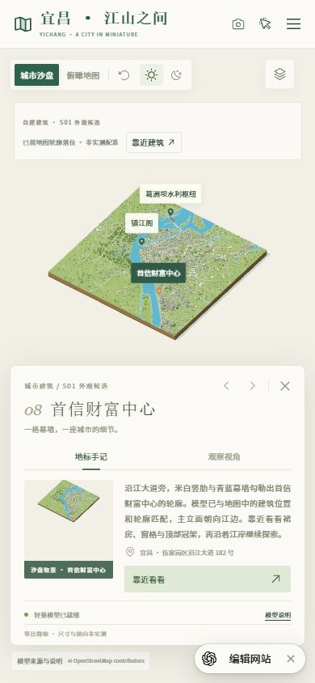

# 首信地图落位 · 浏览器验证

2026-11-09，验证原站「宜昌 · 江山之间」V17，源码 `77f4a948fcbbb21dfad7fd9d894bb74a66dc9dbe`。生产地址：<https://yichang-miniature-city.gaoronghai.chatgpt.site>。

本记录与截图在运行代码发布后补录；本次归档只增加文档和证据，没有改变经过验证的运行代码、地图或模型。地图身份、坐标系、轮廓匹配、朝向和尺寸边界见[地图配准说明](shouxin-geographic-registration-20261109.md)。

## 验证环境

- 使用已连接的 Chrome，真实 WebGL 页面，画面引擎为 Three.js r170。
- 默认桌面视口截图为 1920 × 863。
- 响应式视口为 390 × 844，完成后已恢复默认视口。
- 此前托管预览环境无法创建 WebGL 上下文；本轮画面结论来自上述 Chrome，不来自托管预览或仅有的构建成功。
- 未使用物理手机，未取得实机帧率、温升或电量基准，也没有现场测量。

## 实际操作与结果

| 操作 | 观察结果 |
| --- | --- |
| 初次打开全景，未选择首信 | 完整城市可见；首信标签位于江岸片区，`residentModels=1`、`modelQuality=light` |
| 从目录选择首信 | 模型在沿江道路内侧，与周边楼群一起显示；脚下无板外展台，没有重叠背景楼 |
| 靠近看看 | 页面从轻量版切换到“完整细节已就绪”，`modelQuality=detail`；位置、底部和比例无跳变 |
| 正立面、顶部与轮廓 | 镜头跟随地图内建筑；正面朝江，俯视占地与底图方向一致；没有裁掉整个楼体 |
| 日景 → 夜景 → 日景 | 页面主题与沙盘材质一起切换；建筑仍在原锚点，城市未隐藏 |
| 连同沙盘看 | 整城入镜；`modelQuality=light`、`residentModels=1`、`cityVisible=true`，仅释放近景细节 |
| 选择镇江阁，再回到全景 | 首信轻量版仍常驻，`authoredSelection=false` 时 `residentModels=1` |
| 点击“查看首信财富中心”地图标签 | 正常回到首信介绍和建筑视角 |
| 直接点击真实模型立面 | 实际画面中的立面点击触发首信选中，并将“观察视角”切回“地标手记”，证明网格拾取链有效 |
| 搜索“首信” | 目录只剩首信；清空后恢复原八项目录 |
| 打开模型说明 | 显示地图级配准、非实测限制，原交接说明与新增地图配准依据链接均存在 |
| 390 × 844 常规、近景、整城视角 | 模型和标签均能看到，介绍面板未遮住完整楼体；`clientWidth=scrollWidth=390` |
| 浏览器错误与警告日志 | 检查时返回空列表；未观察到模型载入错误或 WebGL 崩溃 |

所检视角中选中模型的锚点一致：`[51.34617680525723,0.06500000000001162,67.06554042331489]`。Y 是沙盘展示地面高度，不是海拔。

本轮重跑并通过真实 GLB 生命周期 11 项检查、地图注册几何 5 组检查，以及原七处地标的既有配准检查。真实顶点包含、道路/水面净距、唯一背景替换、轻重模型边界一致和局部高度过渡都有独立几何核对；具体算法和数值见 `scripts/check-authored-registration.mjs` 的输出。这些检查不证明真实建筑尺寸已经测定。

## 截图

### 桌面：地图内的建筑与周边环境

### 桌面：城市全景

### 桌面：夜景

### 响应式：近景与全景

## 验收范围

本轮解决板外展示、坐标基准不一致、模型与背景重复，以及退出近景时模型消失的问题。首信仍为 S01 外观候选；楼高、精确真北角、完整背面和屋顶尚未完成实景或测量验收。其他建筑模型不属于此次已接入范围。
