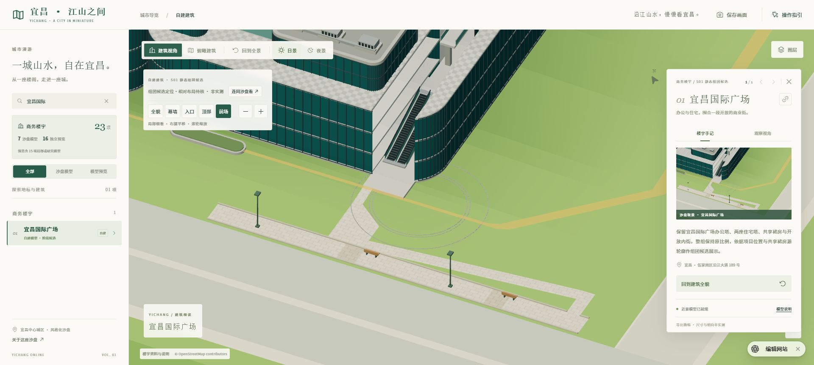

# 宜昌国际广场：通道、前场与沿街空间衔接

日期：2026-11-10。基线为原站 V53，提交 `9c047f9efb5a2c5273c6015cbb823c65c92738f6`。

原站：<https://yichang-miniature-city.gaoronghai.chatgpt.site>；项目 `appgprj_6af0b8d6dbec81919ea6c30c51e88270`。本轮始终修改原站，保留 owner-private audience。

V54 应用提交 `e9f64532da793703f66ae7096b4aa454e9652b78`，完成地面、前场预设、分享与响应式控制；V55 提交 `89229a9122d46ae64a5b4c57f8ac8a1dff3271d1`，根据实际页面将前场取景从正方形范围改为真实地面、灯柱及既有通道的投影包络。最终应用 JavaScript 为 `/assets/index-CfC8Laf3.js`。此后的提交只归档本报告和实际页面截图，不改变应用代码。

## 完成的场景

沿宜昌国际广场模型现有东侧通道的真实铺装前缘，连接到沿江大道 `way/1543968654` 同侧的人行带。新连接在原模型前方的装饰环下补低位铺装，之后沿模型完整包络之外延伸，再接道路外侧的人行空间。没有改变原模型文件、锚点、朝向、统一缩放或原道路数据。

| 项目 | 本轮结果 |
|---|---:|
| 新铺装单元 | 42 |
| 原始路缘段 | 41 |
| 路灯 / 长椅 | 2 / 2 |
| 新增树木 | 0 |
| 原通道出口连接宽度 | 约 1.406 展示米 |
| 外侧沿街升坡长度 | 约 32.622 展示米 |
| 沿街人行带长度 / 宽度 | 约 56.807 / 3.6 展示米 |
| 模型包络内的限定单元 | 4 段窄坡 + 2 块环下铺装 |
| 模型包络外的铺装单元 | 36 |

这处独立记为 `street-frontage`，`entranceRoute` 为空。总计为 **7 处建筑街道样板、6 条既有入口方向连接、1 条本轮前场连接，以及 1 条首信—九州补齐街段**。它没有增加新的完整建筑模型；目录仍为 7 项沙盘模型和 16 项独立预览。

### 为什么这样接

源模型的圆形前场构件是三条窄装饰环，并非一整块实体铺装；相同材质节点还合并了多层楼板，不能把节点包络当作地面。独立解码原始三角面后，确定东通道前缘、窄坡出口及环下范围。

既有模型和道路采用不同展示抬升。直接短接会产生陡坡，因此保留原基准，在包络外沿街延长连接。起坡实际最大坡度约 9.806%，外侧实场坡度约 8.458%；这些是展示几何数值，**不是实测坡度或无障碍路线认证**。三塔组团的定位及相对布局仍为待核候选；接到模型内通道不代表已确认真实入口、场地权属或公共通行范围。

## 观察与交互

国际广场新增“前场”按钮，显示原通道、圆环和完整新连接。最终视角使用 182 个实际取景点：全部新增地面顶点、两根灯柱顶部、原通道前段和原装饰环包络，按实际可用视口适配。全貌仍走原来的整楼拟合算法；幕墙、入口、顶部和俯瞰仍保留。

按钮只对成功生成前场的地点开放。如果来源或障碍条件变化导致整处连接被拒绝，旧 frontage 分享链接会归一化到全貌；定位同步依据实际应用状态更新，避免 URL 等待一个不会出现的预设状态。

桌面五个观察按钮保持在原 304 × 144 像素说明卡片内，未扩大卡片、改变整楼取景可用区。390 像素宽时控制保持一行；320 像素宽时缩放控制换行，实测无横向溢出。相机会依据说明卡和介绍卡的实际尺寸重新拟合。

## 几何与回归证据

源审计使用 NodeIO；独立验证使用 Three GLTFLoader 与 MeshoptDecoder。两种解码路径核对了 GLB 身份、真实低层地面与装饰环。实际渲染校验对 84 个 Float32 新铺装三角逐个裁切源三角，检查完整交叠区域及侧壁，而非只检查顶点或包围盒。

| 校验 | 结果 |
|---|---:|
| Light / Detail 总源三角 | 132,122 / 738,676 |
| 最终铺装高度范围内可能相关的源三角 | 13,474 / 41,522 |
| 非装饰原生几何内部冲突 | 0 |
| Detail / Light 环下最小法向净距 | 0.034372 / 0.034436 展示米 |
| 原通道连接高度误差 | 2.10 × 10⁻⁹ 世界单位 |
| 原通道端点最大误差 | 8.50 × 10⁻⁷ 世界单位 |
| 内部完整宽度拼接 | 7 处全部通过 |
| 拼接两侧最终 Float32 XYZ | 完全一致 |

只对已固定身份、位置和高度的两块狭窄原生坐标区域允许进入自身模型包络。环下重叠仅接受被准确识别的保留装饰环，所有非装饰构件及其它建筑、道路、水体继续执行完整避让。八个完整设计区域由固定原生坐标与真实源道路重建后独立验面积，没有拿已接受单元自证完整性。缺少模型、来源 SHA 改变、桥梁、隧道、非零层道路、建筑阻挡和水体冲突等 7 项失效条件均拒绝生成整处连接。

旧六处样板与首信—九州段的完整规划 SHA、实际几何、索引、UV 和实例矩阵缓冲 SHA 全部与 V53 一致。两级国际广场 GLB 也没有修改。

通过的自动检查：

- `check-international-street.mjs`：原生三角完整区域、实际 Float32 接缝、覆盖、源身份、障碍、资源预算及失效条件。
- `check-street-details.mjs`：7 处样板及旧连接段的完整轮廓避让、零重复面积、独立连接语义与 LOD。
- `check-street-appearance.mjs`：纹理、法线、UV、绿化安全边界、日夜切换和资源释放。
- `check-street-surface-geometry.mjs`：既有完整路缘与开口校验原样通过，没有放宽阈值。
- `check-continuous-streets.mjs`、`check-street-paving-partition.mjs`：原连续街段与铺装分片回归。
- `check-city-render-lifecycle.mjs`：12 项场景生命周期检查；7 栋楼的桌面、390 像素收起/展开介绍下完整取景；新前场全部地面顶点及原接点避让 UI；切回全貌准确恢复相机；停止操作后停止调度。
- `check-scene-location.mjs`：frontage 分享与旧预设往返、不同地点允许角度、输入边界。
- `check-scene-location-hook.mjs`：7 项真实 hook 调度与 history 回归；运行时降级、后续地点与视角同步、前进后退、旧 void 回调和卸载。负向控制加载 V53 原 hook 时能检出 pending 卡住的问题。
- 官方生产构建、`git diff --check` 通过。既有大 JavaScript chunk 提示仍存在，本轮没有改变打包策略。

源代码生命周期检查使用模拟 GPU renderer，仅验证调度与相机状态，不能代替真实设备帧时测量。

## 资源成本

下表仅计算街道细节层的实际几何和实例缓冲，含隐藏的夜景网格：

| 项目 | V53 | 本轮 | 增量 |
|---|---:|---:|---:|
| Mesh | 80 | 88 | +8 |
| 三角形 | 11,996 | 12,602 | +606 |
| 几何与实例缓冲字节 | 500,820 | 536,096 | +35,276 |
| 共享铺装纹理 | 1 | 1 | 0 |
| 全部样板同时近景显示的日景调用 | 74 | 81 | +7 |
| 全部样板同时近景显示的夜景调用 | 80 | 88 | +8 |

新增前场在中景只绘制 3 次、近景日景 7 次、夜景 8 次。全景尺度、图层关闭或视锥外均为 0 次新增绘制。共享纹理源数据仍为 262,144 字节，RGBA8 完整 mip 链理论存储为 349,524 字节；这些不是驱动层实际显存总量。

## 真实 Chrome 验收

图片来自原站发布页面，未作效果图处理。国际广场全貌前后均使用同一 Chrome、1920 × 863 视口、1616 × 793 canvas、日景、相同图层与全貌预设；说明卡、工具条、介绍卡矩形也逐项相同。都是 7 项常驻模型、1 项选中精细模型，锚点一致。

| 同条件全貌项目 | V53 | 最终应用 |
|---|---:|---:|
| 绘制调用 | 89 | 96 |
| 三角形 | 1,449,430 | 1,449,988 |
| 可见街道调用 | 12 | 19 |
| 停止操作后 | idle | idle |

日景可见三角增量为 558；新增总资源的另外 48 个三角用于夜景灯下光斑。旧入口预设在 V53 与 V54 的同条件截图中均为 58 次调用、1,351,738 个三角、0 次街道调用；V55 只收紧了前场预设，原入口参数与算法未改。

最终前场实页日景为 62 次总调用、其中 7 次街道调用；夜景为 66 次总调用、其中 8 次街道调用。夜景的全城既有材质/对象也有变化，不能把总调用差额全部归到本次街灯。关闭街道后主视图保留原通道、三环和基础道路，街道调用为 0。全景关闭江面动态时恢复 idle，街道调用为 0；验收后恢复原江面动态设置。

390 × 844 与 320 × 740 的浏览器响应式检查通过，涵盖前场、介绍展开/收起，以及 320 宽度下返回全貌。临时视口已重置。复制按钮在此浏览器中触发了既有“可选中复制链接”弹窗，弹窗 URL 正确包含 frontage；重新载入该 URL 后按钮保持选中、精细模型加载完成，控制台警告与错误记录为空。没有声称系统剪贴板自动写入成功。

前后浏览器使用了不同模型查看历史，缓存中的纹理和几何对象数量不作内存对比。没有采集 CPU/GPU 帧时、帧率、温升或实体手机性能数据；上述窄屏检查不等同于真机测试。

### 截图与数据

- `before-international-whole.jpg` / `after-international-whole.jpg`：相同条件全貌。
- `before-international-entrance.jpg` / `after-international-entrance.jpg`：保留的办公入口预设。
- `frontage-final.jpg`：最终前场视角及重新载入结果。
- `frontage-night.jpg` / `street-details-off.jpg`：夜景与关闭街道细节。
- `mobile-390-frontage.jpg` / `mobile-390-expanded.jpg`：390 宽度及展开介绍。
- `mobile-320-frontage.jpg` / `mobile-320-whole.jpg`：320 宽度的换行控制与全貌恢复。
- `overview-static.jpg`：返回全景。
- `before-browser.json`、`before-layout.json`、`after-browser.json`、`reload-browser.json`：实际 DOM 观测。
- 本目录的 `lifecycle.json`、`location-presets.json`、`location-hook.json` 以及 `docs/iterations/20261110-international-*.json`：自动检查及源证据。

## 下一轮适合处理的范围

七处地面样板已形成基础。可继续检查万达与国际广场之间的沿江界面：先核对已有样板端点、同层道路和中间障碍，再决定可补齐的连续人行段；不能仅因两处道路同名就跨越街口或跨层连接。模型建模与配准待核事项仍单独管理。
