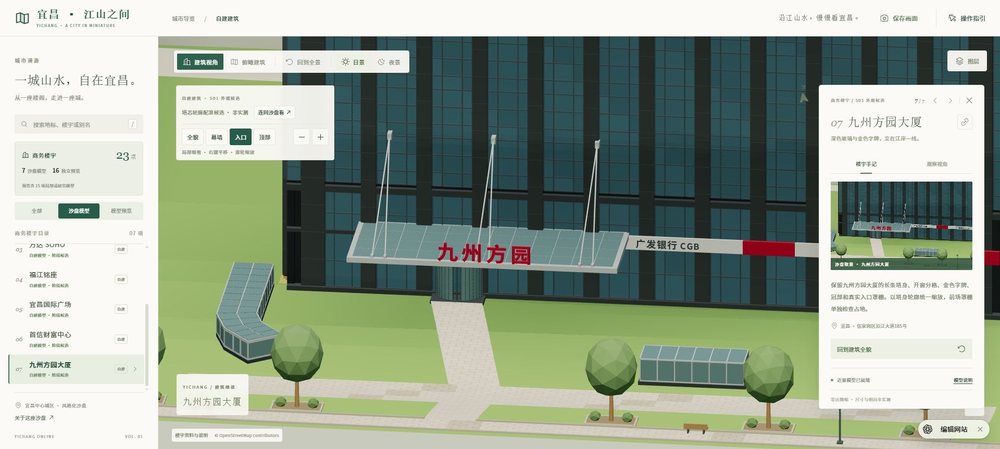
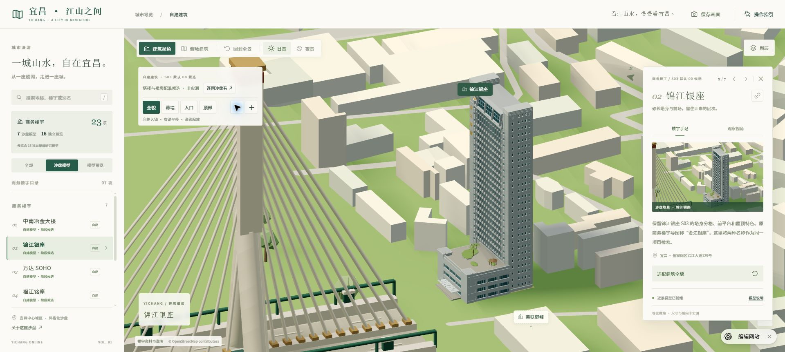
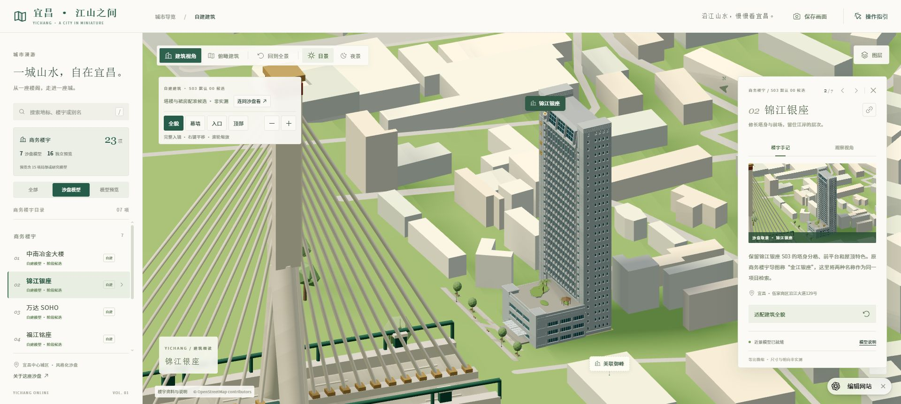
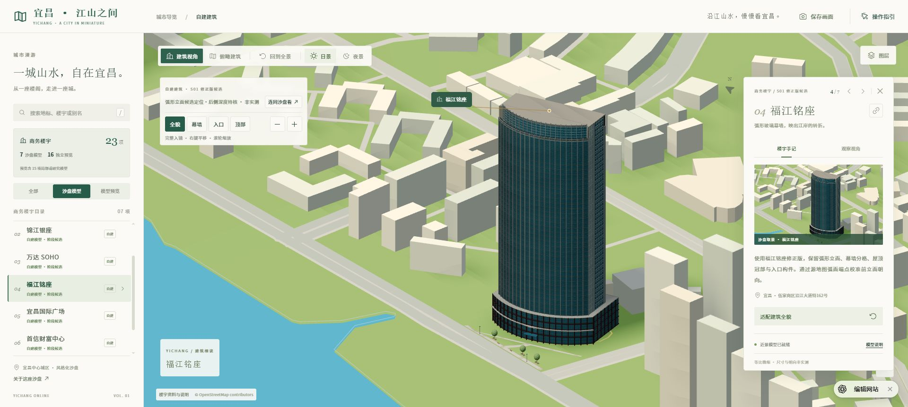

# 重点楼宇街道与地面细化 · 2026-11-10

原站：[宜昌 · 江山之间](https://yichang-miniature-city.gaoronghai.chatgpt.site)。项目 `appgprj_6af0b8d6dbec81919ea6c30c51e88270`。实施基线 V49，源码 `32a74232e5902ee5a7bb77cbfbd8f3d5f421a5a1`。

## 本轮范围

在原有首信、万达、九州方园街道样板上，新增锦江银座与福江铭座的外侧窄前场及同侧人行连接。共五处，均使用既有模型锚点、等比比例、方位和保留的沿江大道几何。模型文件、源城市数据、原相机取景策略及独立模型预览没有修改。

新增两站共141片铺装、124段路缘、7组树木种植池、4盏路灯、4张长椅。锦江外侧前场深度为4m展示尺寸；福江因弧形楼体与道路斜交，采用2m窄带，避免较深方案与自身人行道重叠。完整安全轮廓避让道路、水体、保留楼体及既有样板，证据见 `../../iterations/20261110-extra-street-frontages.json`。

中南冶金需要专门的街角裁剪布局；宜昌国际广场已有内部道路与前场，不能直接套用新的外侧条带。本轮没有扩大这两处。

## 视觉与连接修正

- 共享一张256×256程序石材纹理，添加浅接缝及轻微石材色差。铺装UV使用每站统一的局部平面坐标，共边保持连续；九州门阶的原专用高程与曲面保持。
- 把入口通道末端横穿的建筑侧路缘切开，切口贯穿缘石自身厚度，保留车行道侧。既有三站及新增两站的开口均独立验证；当前开口约4.6m展示宽度，追加贯穿约0.1m，源道路和铺装不移动。
- 路缘增加贴地薄侧面，仍按站点合为一个网格；没有给每块铺装增加框线。
- 原树位保留，树池改为4.6×2.3m条形种植池，加两簇低矮植物；全部几何仍位于原先验证的2.8m树木安全范围内。
- 沿街绿化按投影冠幅3px进入、2.4px退出，在街区尺度先于灯具和长椅出现；家具保留原9px/6.5px道路宽度阈值。街道开关与树木开关继续生效，静止后没有常驻动画。

所有前场、纹理、植物和设施属于展示设计，不代表实测入口、场地边界或现场植物品种。新增连接从完整模型范围之外开始，未新增模型内部走廊豁免。未新增推测的车道线、停车线、停止线或斑马线。

## 资源预算

| 全部街道样板 | V49（三站） | 本轮（五站） |
|---|---:|---:|
| 合计网格 | 36 | 65 |
| 合计三角形 | 5,770 | 10,776 |
| 几何与实例缓冲 | 178,604 bytes | 425,980 bytes |
| 新增铺装纹理 | 0 | 1张，262,144源bytes |
| 全景样板可见绘制 | 0 | 0 |

纹理启用mipmap，完整mip链约349,524 bytes，未包含驱动、材质和框架开销。全站近景全可见时日间预算60次、夜间65次；实际场景会按视野逐站裁剪。不能把几何字节或绘制次数换算为真实设备帧率。

## 已完成的自动检查

- `check-street-details.mjs`：1030个普通完整安全轮廓与8片原九州入口接驳片通过，铺装无面积重叠，5条外侧步行连接连续，原3站规划与首信冻结几何保持。
- `check-street-surface-geometry.mjs`：独立面积算法核查所有开口，无入口残缘；顶面、侧面绕序及法线正确，未相交路缘面积完整保留。
- `check-street-appearance.mjs`：27个树木种植池及植物实例逐顶点通过原16边安全轮廓，种植池最小净距约0.176m；2417处共享顶点UV连续，九州48个接驳顶点高程保持。共享纹理、透明度、mipmap、绿化滞回、图层开关及去重释放检查通过。
- `check-city-render-lifecycle.mjs`：真实场景工厂11项生命周期检查及7项建筑在桌面、窄屏展开/收起介绍共21种完整取景通过；该检查不代替真实WebGL验收。
- 生产构建通过。保留原Vite单包体积提示，没有在本轮扩大到依赖拆包。

## 浏览器对照

基线截图与页面渲染计数在本目录 `before-*`，使用已连接Chrome、1920×863视口，锦江与福江均在目录默认全貌后缩小一档，以同时观察建筑与街道；首信为默认全貌。更新后的同条件记录在 `after-browser.json` 与 `after-*` 原图。

本地云端预览浏览器已知禁用WebGL，三维画面在原站正式地址验收。窄屏检查为桌面浏览器模拟，未进行实体手机帧率测试。

## 正式站点验收结果

实际应用发布为V50，源码 `8a6f598cad18e8f73708a6e50c3dcd61e872beb6`，浏览器确认加载 `/assets/index-BYswLSmh.js`。后续归档版本使用同一应用构建。

| 同一浏览器、同一机位 | 绘制调用 V49 → 本轮 | 三角面 V49 → 本轮 | 停止操作后 |
|---|---:|---:|---|
| 全景1920×863 | 258 → 258 | 1,313,930 → 1,313,930 | idle |
| 首信默认全貌 | 93 → 95 | 779,756 → 780,838 | idle |
| 锦江全貌缩小一档 | 61 → 73 | 667,853 → 669,399 | idle |
| 福江全貌缩小一档 | 69 → 81 | 1,149,798 → 1,151,162 | idle |

资源总预算与某个机位的可见数不同；新增预留区也会改变程序生成的背景树位置。GPU已分配geometry数受此前浏览路径影响，原始记录保留该数，本表不将不同浏览历史的geometry计数当成内存对比。共享纹理在访问近景后使全景纹理计数14→15。

- 锦江原楼体、屋顶露台及既有前场构件完整保留，新增步行带及4组树池在模型外侧；福江的弧形楼体与窄前场、人行道连成可辨的街道关系。两处实际画面与来源配置相符。
- 九州入口实景确认石材铺装从原门阶接出，纹理连续，通道在人行道边缘没有横穿的矮路缘，原模型中的独立构件保留。该机位66次绘制、732,194三角面，idle。
- 福江夜景为85次绘制、1,151,210三角面，关闭“街道细节”后为72次、1,149,798，新增样板可见网格归零且原道路保留；重新打开回到13个样板网格，idle。山林与树木开关可用并恢复开启，最终恢复日景。
- 390×844福江全貌保留楼顶、楼底及周边街道，介绍自动收起，页面scrollWidth为390，无横向溢出；71次绘制、1,050,268三角面，idle。临时视口已恢复。
- 搜索镇江阁与九州、目录选择和入口预设正常。镇江阁读取为53次绘制、638,596三角面，与保留版本一致；“江面动态”处于开启状态，所以该视野为active，不能计为按需渲染失效。
- 正式应用warn/error日志为空。第一次刷新等待模型就绪、以及镇江阁等待idle均有一次自动化等待未满足；后者由开启的江面动态解释。镇江阁补充截图调用未返回，已终止该调用并恢复浏览器连接，该截图不计入视觉验收；其源码与模型未修改，已复核当前渲染计数和动态开关。

源城市数据、注册与模型配置、模型加载、原相机工厂、建筑观察点以及独立模型查看器逐文件与V49比对无差异。可见改动仅在街道规划配置、街道材质/几何/显隐规则及说明文字。

### 画面对照

九州入口近景：

锦江更新前与更新后：

福江更新后：

