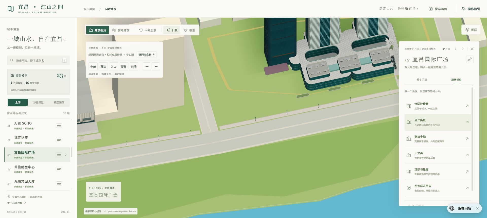

# 万达路口两侧沿江街道延伸：实现与验收

日期：2026-11-10  
原站：宜昌 · 江山之间（宜昌Online）  
项目：`appgprj_6af0b8d6dbec81919ea6c30c51e88270`

## 交付结果

万达 SOHO 与宜昌国际广场各自已有的人行道，分别延伸至万达路口前。新增铺装、纵向路缘和 7 盏同款路灯，补齐两处样板与街口之间的地面空间。两侧之间保留万达路车行开口，不能解读为两座建筑已经跨路口步行连通。

在两座楼的「观察视角」页增加「沿江街景」，可直接查看两侧延伸与中间街口。原全貌、幕墙、入口、顶部，以及国际广场的前场观察继续保留；窄屏点击街景时自动收起介绍。

[直接查看沿江街景](https://yichang-miniature-city.gaoronghai.chatgpt.site/#place=yichang-international-s01&angle=streetscape&close=1)

## 范围与依据

以下尺寸均为当前沙盘几何计算的**展示尺寸**，不是实测尺寸、已确认的公共通行边界或无障碍路线。

| 项目 | 国际广场侧 | 万达侧 |
|---|---:|---:|
| 新增人行道长度 | 143.4523 m | 92.0466 m |
| 铺装宽度 | 3.6 m | 3.6 m |
| 铺装单元 | 48 | 31 |
| 纵向路缘段 | 96 | 62 |
| 新增路灯 | 4 | 3 |
| 完整铺装及路缘至万达路车行域的最小净距 | 2.0026 m | 2.0041 m |
| 计入万达路装饰外缘后的净距 | 1.4581 m | 1.4596 m |

合计新增 235.4989 展示米、847.7959 展示平方米铺装。沿沿江大道原道路里程，两端之间保留 17.77 展示米；两个完整新增域的最短几何距离为 17.3475 展示米。这两项距离含义不同。

沿江大道使用保留源线 `way/1543968654`。两条万达路源线 `way/1070095025`、`way/1070095026` 穿过原拟连接区域，故两段分别停止在路口前。源资料中的默认地面规则与估计宽度不能证明现场过街关系；本轮没有生成斑马线、停止线或跨口铺装。

两段以独立 `street-extension` 保存，各自只接回自己的原样板。源道路、层级、宽度、端点或完整障碍检查失败时，两段及街景视角一并停止生成；已有样板仍保留。新对象没有被统计为新的楼宇样板或跨楼连接。

## 接缝、设施与既有场景

- 两端直接接到原人行道的完整 3.6 m 横边，实际 Float32 顶点 XYZ、路缘基顶与纹理 UV 逐点一致。万达原端内外高程不同，其横坡得到保留。
- 新增铺装、完整纵缘及灯具安全范围，避让全部现存道路、保留建筑面、精细模型包络、水体和旧设施。灯杆、灯头及 168 个实际光斑三角形另作独立检查。
- 原七处街道样板和首信—九州补齐段，在平地与实际地形下的完整规划和渲染缓冲 SHA 比对均与 V56 相同。
- 建筑文件、地理锚点、方位、比例和原道路源坐标、宽度保持原值。目录仍为 7 项沙盘模型与 16 项独立预览；23 个查看入口不代表 23 个完整楼宇模型。

## 实际近景暴露的路口条纹

V57 的实际日夜街景在万达路口出现原有细条纹。关闭「街道细节」后仍存在，定位到基础道路的层叠绘制。独立数值检查发现，所查交叠路面之间的高度差很小，原本所有路面又采用相同绘制序号，符合深度量化竞争的特征。

V58 将基础路面按原道路等级由低至高绘制，保持深度测试、几何、宽度和材质不变。相同机位的日景与夜景复核中，原条纹消失，绘制调用和三角形数量保持一致。

这是所查路口的渲染修正，不表示全城所有真实几何交叉已解决。报告中的 24 位深度缓冲计算只是说明性假设，未实测设备的深度位数。

| 视觉证据 | 修正前 V57 | 修正后 V58 |
|---|---|---|
| 日景同机位 | [日景原图](v57-streetscape-day-before-junction-fix.jpg) | [日景修正后](v58-junction-fixed-day.jpg) |
| 夜景同机位 | [夜景原图](v57-streetscape-night-before-junction-fix.jpg) | [夜景修正后](v58-junction-fixed-night.jpg) |

## 资源与同条件浏览器对比

### 街道几何成本

| 指标 | V56 原 8 组 | 本轮全部 10 组 | 增量 |
|---|---:|---:|---:|
| Mesh 对象 | 88 | 98 | +10 |
| 三角形 | 12,602 | 14,312 | +1,710 |
| 几何及实例缓冲 | 536,096 B | 631,340 B | +95,244 B |
| 共享铺装纹理 | 1 | 1 | +0 |

新增部分控制在 10 个对象、1,800 个三角形、100,000 字节和零新增纹理的独立预算内。95,244 B 约为 93.0 KiB；该数值是几何及实例缓冲，不是全部网页、模型文件或总 GPU 内存。

所有街道组都在视野内、近景细节全部展开时，日景为 89 次、夜景为 98 次街道绘制。全景尺度下为零。关闭街道细节、处于视野外或缩回全景时，新增组同样不绘制。

### 实际浏览器同条件样本

同一连接 Chrome、1920 × 919 窗口、1616 × 849 画布、万达全貌、日景、7 个常驻模型与 1 个选中精细模型，均等待静止后读取：

| 指标 | V56 | V57 |
|---|---:|---:|
| 整个场景绘制调用 | 92 | 100 |
| 整个场景三角形 | 1,216,130 | 1,217,672 |
| 当前已上传纹理数 | 14 | 14 |
| 当前可见街道调用 | 12 | 20 |
| 渲染状态 | idle | idle |

[V56 同机位原图](v56-wanda-whole-before.jpg) · [V57 同机位原图](v57-wanda-whole-after.jpg)

V57→V58 的路口修正，在同一万达街景机位下，日景保持 90 次调用 / 986,026 三角形，夜景保持 96 次调用 / 986,242 三角形。

后续窗口高度变为 863，最终截图画布为 1616 × 793；它以及多次浏览后累计的纹理/几何计数不纳入上述同条件比较。这些记录不替代 FPS、耗电、冷启动或实体手机测试。

## 验收记录

自动检查通过：

- 新延伸的完整区域覆盖、道路与障碍净距、实际顶点和 UV 接缝、实例灯具与光斑、35 个失败用例、资源与显示生命周期。
- 原街道 details、appearance、surface、International、continuous 五项回归。原 8 组预算单独保留，全部 10 组由新检查验证；没有放宽旧预算。
- 城市场景 13 项生命周期与取景检查，包含 7 座楼的整楼/局部取景、桌面及 390 宽介绍展开/收起、国际广场原前场、新街景完整铺装/路缘/灯具入镜，以及回到全貌的原机位恢复。
- 位置链接规范化与导航恢复；基础道路 8 项检查；生产构建。

实际浏览器确认：

- 两座楼都可进入沿江街景，并保持各自选中状态。
- 日夜切换、街道关闭归零及恢复、返回全景、原国际广场前场、320 宽回到整楼均正常。
- 390 × 844 下检查介绍展开与收起；320 × 740 下检查街景和整楼，未见页面横向溢出。窄屏点击街景会收起介绍。以上是桌面浏览器尺寸检查，不是实体手机测试。
- 夜景街景地址重载后恢复原建筑、街景角度与夜景状态。复制按钮显示成功，但浏览器工具返回的剪贴板文本为空，未独立验证剪贴板内容；本轮验证的是实际地址栏链接的重载恢复。
- 最终控制台没有捕获到 error/warn。临时视口覆盖已清除，「江面动态」恢复原开启设置，最终停在国际广场的日景街景。

窄屏原图：[390 展开](v57-responsive-390-expanded.jpg) · [390 收起](v57-responsive-390-collapsed.jpg) · [320 街景](v58-responsive-320-streetscape.jpg) · [320 整楼](v58-responsive-320-whole.jpg)

## 版本与证据索引

- 起点：V56，`7eb9d5f5f868d08ef4bb123350058f9efcfa9edd`。
- 街道实现：V57，`f26755fb1a73ea8e151bc4ab2d3d6b6754eb5224`。
- 路口修正及最终验收代码：V58，`4c5ec9b707e8f5126df5a518b0f26f35d2fc809a`，应用脚本 `index-Cyb37a5N.js`。
- 随后的验收归档版本只增加报告和截图，保持上述应用脚本。
- [实际浏览器记录](browser-verification.json)
- [V56 原组基线](../../iterations/20261110-wanda-international-baseline.json)
- [源道路及完整空间审计](../../iterations/20261110-wanda-international-corridor-audit.json)
- [独立几何和资源验证](../../iterations/20261110-wanda-international-validation.json)
- [原五项回归结果](../../iterations/20261110-wanda-international-regression.json)
- [万达路口绘制诊断](../../iterations/20261110-wanda-junction-render-audit.json)

实施前、两次代码发布前均读取了原站最新状态；通过原项目的源码工作流重新协调远端后提交与发布。没有另建网站。
